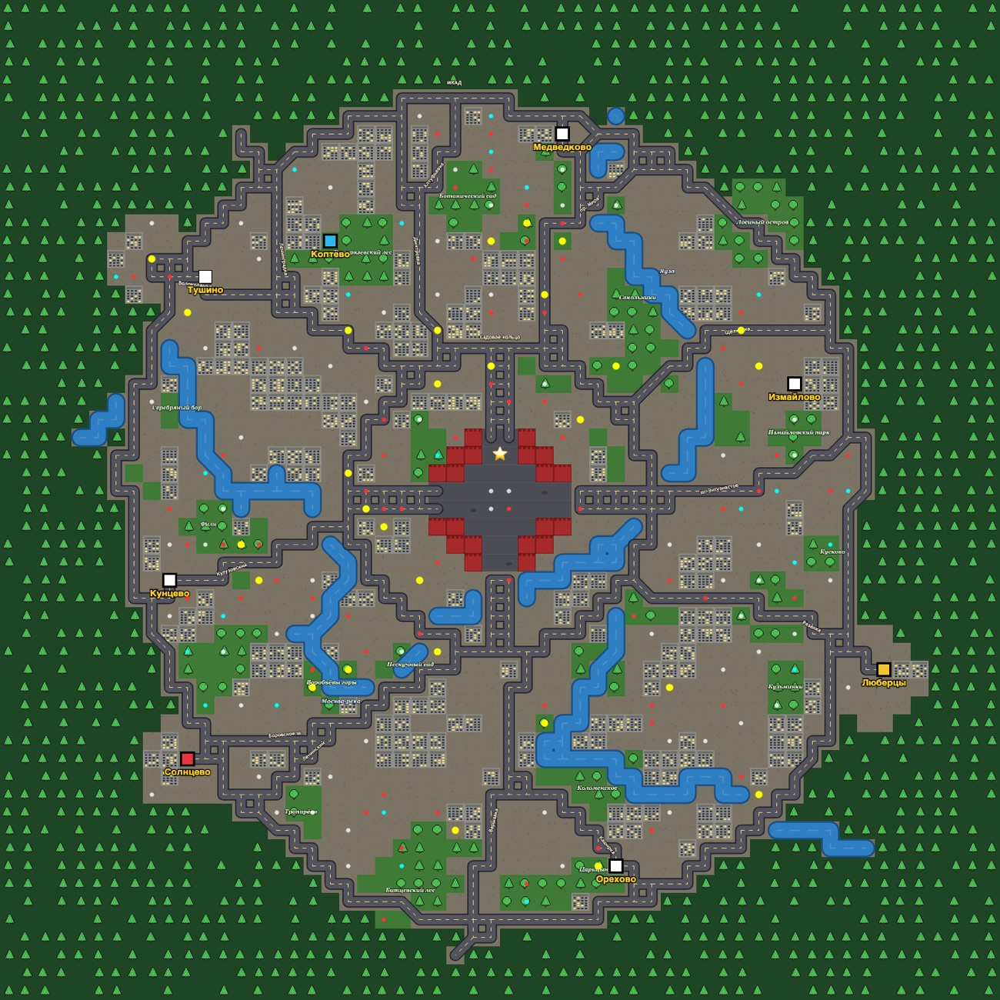

# ДЕЛЁЖ

Пошаговая стратегия про Москву 90-х в духе «Героев»: карта, герои, города, тактический бой.
От двух до шести бригад по очереди за одним компьютером: люди и боты трёх уровней сложности в любом сочетании.

Карта — настоящая Москва 90-х: река и мосты, МКАД, шоссе, Лужники, Черкизон, Горбушка, Останкино, Бутырка.

Играть: https://delyozh.axellkir.tech



## Локально

```bash
npm install
npm start        # http://localhost:8777
npm test         # ИИ доигрывает восемь партий в Chrome без окна (люди, боты, обе карты)
npm run test:online   # два браузера играют партию по сети через сервер комнат
```

Сборки нет: `index.html` + `js/*.js`, обычные скрипты с общими глобалами. `npm run build` только
кладёт копию в `dist/` и вписывает номер версии.

## Выпуск версии

```bash
npm run release              # 0.1.0 → 0.1.1
BUMP=minor npm run release   # 0.1.1 → 0.2.0
```

Команда ставит тег `vX.Y.Z` и пушит его. Дальше GitHub Actions (`.github/workflows/release.yml`):
тесты → архив в Releases → выкладка на сервер → проверка, что сервер отдаёт эту версию.
Номер версии виден в правом нижнем углу меню.

Обычный пуш в `main` только прогоняет тесты (`ci.yml`), на сервер ничего не уходит.

## Игра по сети

В меню: «Создать комнату» → отправить друзьям ссылку или код. Сервер комнат — `server/server.mjs`, без зависимостей;
локально он запускается вместе с игрой (`npm start`). Пока бригады далеко, день играют все одновременно; сошлись — по очереди, и защитник сам командует своими отрядами. Как устроены ход и передача партии — в `docs/BACKLOG.md`, раздел 3.

## Сервер

nginx отдаёт `/var/www/delyozh`, конфиг — `deploy/nginx-delyozh.conf`. Выкладывает пользователь
`deploy`: его ключ умеет только писать в папку сайта. Ключ и адрес лежат в секретах репозитория
(`DEPLOY_SSH_KEY`, `DEPLOY_KNOWN_HOSTS`) и переменных (`DEPLOY_HOST`, `DEPLOY_USER`, `DEPLOY_DOMAIN`).

Сервер комнат работает службой `delyozh-server` (файлы — в `deploy/`), nginx отдаёт ему `/api/`. После выкладки
меняется `version.json`, и systemd сам перезапускает службу — ключу выкладки права на это не нужны. Комнаты лежат в `/var/lib/delyozh`.

`node tests/shot.mjs <папка>` снимает карту целиком и вблизи без окна — посмотреть, что нарисовалось.

Планы — в [docs/BACKLOG.md](docs/BACKLOG.md). Как заменить подложку карты рисунком — [docs/MAP-ART.md](docs/MAP-ART.md).
